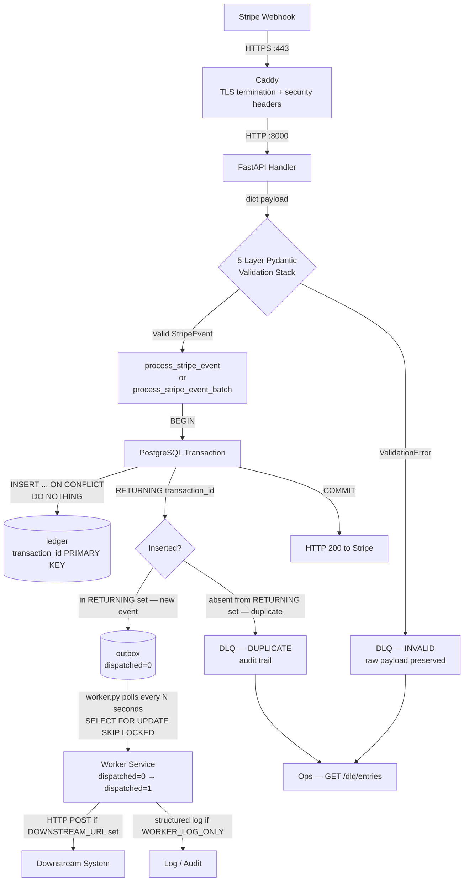

# Micro-Billing-Ledger PoC
### Idempotent Stripe Webhook Ingestion — PostgreSQL · Pydantic v2 · FastAPI

[](https://github.com/DDRG15/micro-billing-ledger-poc/actions/workflows/test.yml)
[](https://github.com/DDRG15/micro-billing-ledger-poc/actions/workflows/lint.yml)
[](https://github.com/DDRG15/micro-billing-ledger-poc/actions/workflows/stack.yml)

**Status: Proof of Concept.** This demonstrates specific architectural decisions — idempotent inserts, Transactional Outbox, SELECT FOR UPDATE SKIP LOCKED — in a working system. It is not production software. The Production Gap Checklist at the bottom of this file is now fully closed; what remains genuinely out of scope is listed there as *Not attempted*, with the reason.

**Stack:** Python 3.12–3.13 · FastAPI · Pydantic v2 · psycopg2 · PostgreSQL 16 · Docker Compose  
**Tests:** 213 / 213 — no mocks, no stubs, every assertion hits a live PostgreSQL database  
**Throughput:** ~5,000 TPS batch ingest (`execute_values`) · 26 TPS per-event, the cost of 4 synchronous round trips per event · measured on Docker-on-Windows localhost, see Performance Benchmarks

---

## The Problem

Stripe delivers webhooks with **at-least-once** guarantees. If your ingestion layer looks like this, you are double-counting revenue:

```python
# WRONG — classic race window
if not db.exists(event_id):
    db.insert(event)          # another thread just did this 2ms ago
    revenue_ledger.credit()   # ghost payment: credited twice, exists in DB, not in reality
```

Two concurrent retries pass the `exists()` check before either commits. The result is a **Ghost Payment** — a ledger row that exists in your database but doesn't correspond to a real financial event. Recovery requires manual forensics.

---

## Quick Start

**Prerequisites:** [Docker Desktop](https://www.docker.com/products/docker-desktop/) · Python 3.12 or 3.13

```bash
# 1. Configure environment — the dev defaults work as-is
cp .env.example .env
# Every compose variable also has a built-in dev default, so the stack still
# starts without this file. Copy it anyway: it is where you change the values
# marked *** CHANGE *** before anything is reachable from a network.

# 2. Start PostgreSQL
docker compose up -d postgres

# 3. Install Python dependencies
python -m venv venv
source venv/bin/activate          # Windows: venv\Scripts\activate
pip install -r requirements.txt

# 4. Run the full test suite — 213 tests, live PostgreSQL, no mocks
python test_ledger.py

# 5. Start the full stack (postgres + billing + worker + caddy)
docker compose up

# — OR — run the API standalone without the full stack
uvicorn ledger:app --port 8000

# 6. Teardown — stop containers and remove volumes
docker compose down          # keeps pgdata volume (data survives)
docker compose down -v       # wipes pgdata volume (full clean slate)
```

### Send test webhooks

`POST /webhook/stripe` verifies an HMAC-SHA256 signature on **every** request, including
when `STRIPE_WEBHOOK_SECRET` is still the placeholder. That is deliberate — an endpoint
that accepts unsigned requests whenever it is misconfigured fails silently, which is
worse than rejecting everything. So a bare `curl -d '{...}'` correctly returns `400`.

`send_test_webhook.py` signs requests the way Stripe does, using whatever secret the
stack is actually running with. Standard library only — no venv, no Stripe account:

```bash
python send_test_webhook.py --all
```

```
Valid invoice.paid:
  POSTED expected: HTTP 200  {"outcome":"POSTED","transaction_id":"evt_demo_...","reason":null}

Same event twice - the idempotency guard fires on the second:
  1st -> POSTED: HTTP 200        {"outcome":"POSTED",...}
  2nd -> DLQ_DUPLICATE: HTTP 200 {"outcome":"DLQ_DUPLICATE","reason":"Already processed..."}

Invalid payload (currency 'xx' is not a real ISO 4217 code):
  DLQ_INVALID expected: HTTP 200 {"outcome":"DLQ_INVALID","reason":"Pydantic validation failed: 1 errors"}

Failed invoice - amount lives in amount_due, not amount_paid:
  VOID expected, recorded at 7500: HTTP 200  {"outcome":"VOID",...}

Ledger summary:
  summary: HTTP 200  {"ledger":{"VOID":1,"POSTED":2},"dlq_depth":2,"outbox_pending":1}

Prometheus metrics:
  metrics: HTTP 200
      webhook_events_total{outcome="POSTED"} 2.0
      webhook_events_total{outcome="DLQ_DUPLICATE"} 1.0
      webhook_events_total{outcome="DLQ_INVALID"} 1.0
      webhook_events_total{outcome="VOID"} 1.0
      dlq_depth 2.0
      outbox_pending 1.0
```

Individual steps: `--duplicate`, `--invalid`, `--failed`, `--summary`, `--metrics`.
Add `--url https://localhost` to go through Caddy instead of the direct port.

The read endpoints need the API key (`dev_key_change_in_production` by default):

```bash
curl -H "X-Api-Key: dev_key_change_in_production" http://localhost:8000/ledger/summary
curl -H "X-Api-Key: dev_key_change_in_production" "http://localhost:8000/dlq/entries?limit=10"
```

---

## Architecture



### Why this handles concurrent load correctly

`INSERT INTO ledger ... ON CONFLICT (transaction_id) DO NOTHING` is a **database-level serialization point** — not an application lock, not a SELECT-then-INSERT race. Five threads firing the same `event_id` simultaneously all enter the transaction; PostgreSQL's PRIMARY KEY constraint ensures exactly one INSERT wins; all others produce `rowcount=0` (single-event path) or are absent from the `RETURNING` set (batch path). Zero application-level coordination required.

---

## Outbox Worker

The Transactional Outbox pattern guarantees that a `ledger` row and its corresponding `outbox` row are written atomically. Without a drain loop, that guarantee is half-finished: events are recorded but never delivered downstream.

`worker.py` is a standalone Docker service — not a thread inside the API process. An in-process thread shares the connection pool, dies with the web server, and cannot be restarted independently. A separate service has its own lifecycle, its own connection, and its own failure domain.

**`SELECT FOR UPDATE SKIP LOCKED`** is the concurrency mechanism:

```sql
SELECT id, transaction_id, event_type, payload
FROM outbox
WHERE dispatched = 0
ORDER BY id
LIMIT 100
FOR UPDATE SKIP LOCKED;
```

`FOR UPDATE` locks the selected rows for the duration of the transaction. `SKIP LOCKED` skips rows already locked by another worker — rather than blocking, it moves on. Two worker replicas running simultaneously process different rows without any coordination. No event is dispatched twice.

The `dispatched=1` update happens in the **same `BEGIN…COMMIT`** as the dispatch confirmation. A crash before `COMMIT` leaves `dispatched=0` — the event is retried on the next poll. Delivery is at-least-once. The ledger's `ON CONFLICT DO NOTHING` makes receipt exactly-once.

**Fail-fast on misconfiguration:** if `DOWNSTREAM_URL` is empty and `WORKER_LOG_ONLY` is not `"true"`, the worker exits at startup with a structured error. The alternative — marking rows `dispatched=1` without forwarding them — is undetectable data loss.

**Resilience:** `psycopg2.OperationalError` triggers exponential backoff (5 → 10 → 20 → 60s cap) and a reconnect loop. `SIGTERM` sets a stop flag; the worker finishes the current batch then exits 0. This is the correct behavior for Docker rolling deploys and Kubernetes graceful termination.

---

## Security Controls

**Stripe HMAC-SHA256 Signature Verification** — Every inbound webhook is authenticated via `stripe.Webhook.construct_event()` using the endpoint's signing secret. Unsigned or tampered requests return HTTP 400 before touching the database. Verification stays on even when `STRIPE_WEBHOOK_SECRET` is left at its placeholder: an endpoint that accepts unsigned requests whenever it is misconfigured fails silently, which is worse than rejecting everything.

**API Key Authentication** — `/ledger/summary`, `/dlq/entries`, `/dlq/{id}/retry` and `/metrics` require an `X-Api-Key` header validated against the `BILLING_API_KEY` environment variable. Missing or invalid keys return HTTP 401. An empty `BILLING_API_KEY` disables the check entirely for local development, and the application logs a warning at startup when that happens — a fail-open default is defensible, a silent one is not.

**These are engineering controls, not a compliance program.** They address request authenticity and access to operational data. They are not an ISMS, there is no audit trail of who read operational data, no formal risk assessment, and no external audit. See [SECURITY.md](SECURITY.md) for what this project deliberately does not attempt.

---

## Infrastructure Resilience

**Connection Pooling** — `psycopg2.pool.ThreadedConnectionPool(minconn=1, maxconn=20)` replaces the single module-level connection. Each request leases a connection via `getconn()` and returns it in a `finally` block via `putconn()`. No connection exhaustion under concurrent load; no leaked connections on exception paths.

**Async/Sync Thread Dispatch** — All database-hitting routes — `POST /webhook/stripe`, `/ledger/summary`, `/dlq/entries` — are declared `def`, not `async def`. FastAPI runs synchronous routes in an external thread pool, so psycopg2's blocking calls never stall the asyncio event loop. The webhook handler reads the raw body from `request._body` (cached by Starlette when it parses the request) for HMAC verification — no `await` needed.

**Rate Limiting** — `slowapi` enforces 100 req/min on `POST /webhook/stripe`, 20 req/min on `/ledger/summary`, `/dlq/entries` and `/dlq/{id}/retry`, and 60 req/min on `/metrics` (a scraper hits it every 15s), keyed by client IP. A webhook flood without rate limiting exhausts `maxconn=20` and drives `outbox_pending` unbounded. The 429 response instructs Stripe to back off; Stripe's own retry logic handles redelivery.

Behind Caddy the app runs with `--proxy-headers` and trusts `X-Forwarded-For` **only from Caddy's address**, set via `FORWARDED_ALLOW_IPS` and pinned to a static container IP. The limiter therefore keys on the real client rather than the proxy, without letting the client choose its own key.

The obvious shortcut here is wrong and worth stating plainly. `--forwarded-allow-ips=*` sets `always_trust=True` in uvicorn's `ProxyHeadersMiddleware`, which returns `x_forwarded_for_hosts[0]` — the leftmost, entirely caller-supplied entry. Any client can then rotate the header to mint a fresh bucket every 100 requests, or forge a specific customer's IP to poison theirs. Pinning to Caddy's address makes uvicorn walk the header from the right and stop at the first untrusted hop, which is the real client, because Caddy appends rather than overwrites.

One version-specific trap: uvicorn 0.30.6 compares this value as an **exact string**, not a CIDR range. `172.28.0.0/16` matches nothing, silently disabling `X-Forwarded-For` and collapsing the limiter into a single global bucket — the failure looks like a fix. Hence a literal address plus a fixed `ipv4_address` in `docker-compose.yml`.

Verified end to end, not just traced: two containers with distinct addresses hit Caddy, one exhausted its bucket to 429 keyed on its own IP while the other still passed, and a forged header from an untrusted peer no longer reset the limit. `.github/workflows/stack.yml` asserts the bypass stays closed.

**Log Rotation** — `RotatingFileHandler(maxBytes=10MB, backupCount=5)` caps log storage at 50 MB. At 500 TPS under DLQ write failures, each logging a full raw payload as JSON, an unbounded log file fills a typical root partition in under an hour. The 5-file backup retains enough history for forensics without infinite growth.

**Resource Limits** — `deploy.resources.limits: memory: 256M, cpus: 0.50` on the billing container. Without a memory ceiling, an OOM in the billing container can terminate the Docker host process. The hard limit ensures OOM kills the container in isolation.

**Secrets Management** — All credentials are read from `.env` via `${VAR}` substitution in `docker-compose.yml`. No credential appears in source code. `.env.example` is the committed template with safe development defaults; `.env` is gitignored. Rotating a secret requires editing one file and restarting the affected service.

**HTTPS / TLS** — Caddy sits in front of FastAPI as a reverse proxy. Set `CADDY_DOMAIN` in `.env` to a real domain; Caddy requests a Let's Encrypt certificate automatically — no `certbot`, no cron renewal job, no manual certificate rotation. Security headers enforced at the proxy: `X-Frame-Options: DENY`, `X-Content-Type-Options: nosniff`, `Strict-Transport-Security: max-age=31536000`, server fingerprint removed.

---

## 5-Layer Validation Stack

Every Stripe webhook passes through all five layers before touching the database. Any failure routes to DLQ — the raw payload is always preserved byte-perfect.

```
Layer 1 — Pydantic type coercion
  EventType enum                unknown type string → DLQ_INVALID (at model creation)
  StripeObject.customer         min_length=4 → rejects empty strings and short placeholders
  StripeObject.currency         pattern=r"^[a-z]{3}$" → rejects uppercase, 2-char, non-ISO codes
  StripeObject.amount_paid      ge=0 → rejects negative amounts at the Field level

Layer 2 — StripeObject @model_validator
  check_amount_present          either amount_paid OR amount must be non-null

Layer 3 — StripeEvent @model_validator (cross-field)
  resolve_idempotency_key       resolves from request.idempotency_key, falls back to event id
  check_invoice_amount_nonzero  invoice.paid + $0 → DLQ_INVALID (no revenue received)
  check_customer_id_format      customer must start with 'cus_' (structural Stripe API rule)

Layer 4 — Business logic
  _STATUS_MAP[event_type]       POSTED / VOID / PENDING per event type (type-safe dict)
  INSERT ... ON CONFLICT        DB-level idempotency guard — the serialization point

Layer 5 — DLQ routing
  ValidationError  → DLQ_INVALID    (raw payload preserved, reason code structured)
  ON CONFLICT hit  → DLQ_DUPLICATE  (Stripe retry audit trail, payload preserved)
```

---

## Performance Benchmarks

All numbers from `python test_ledger.py` against a live Docker PostgreSQL 16 container.  
Environment: Windows 10 · Docker-on-WSL2 · Python 3.12 · single core · ~8ms/round trip.

### Why single-event was slow (26 TPS)

```
Per event: BEGIN + INSERT ledger + INSERT outbox + COMMIT = 4 round trips
5,000 events × 4 round trips × ~8ms/round trip = ~160 seconds → 26 TPS
```

Each event was a separate synchronous fsync through WAL. The bottleneck was not CPU, not Pydantic, not the constraint check — it was the number of synchronous network round trips to a Docker container on WSL2.

### Why batch is fast (~5,000 TPS)

```
5,000 events → 12 round trips total:
  1  BEGIN
  5  bulk ledger INSERTs  (execute_values, page_size=1000, RETURNING transaction_id)
  5  bulk outbox INSERTs  (execute_values, page_size=1000)
  1  COMMIT
= ~1.0 second elapsed → ~5,000 TPS  (192× improvement)
```

`psycopg2.extras.execute_values` collapses N individual INSERT statements into `ceil(N / page_size)` multi-row statements. PostgreSQL does the same total work; the application makes 192× fewer network calls. `page_size=1000` is chosen because 9 ledger columns × 1,000 rows = 9,000 bind parameters — safely within PostgreSQL's 65,535-parameter statement limit.

### Results

| Path | Events | Time | TPS |
|---|---|---|---|
| Per-event (pre-batch) | 5,000 | ~195s | 26 |
| Batch (`execute_values`) | 5,000 | ~1.0s | ~5,000 |

The 500 TPS floor is a hard test assertion in `test_ledger.py` — not a metric, a test.

---

## Schema

```sql
-- Financial record. transaction_id is PRIMARY KEY and the idempotency guard.
-- ON CONFLICT (transaction_id) DO NOTHING makes replay a zero-lock no-op at DB level.
-- BIGINT: covers amounts up to ~$92 quadrillion (INTEGER max is only ~$21M).
-- CHECK (length(payload) < 50000): prevents unbounded growth from malicious payloads.
CREATE TABLE ledger (
    transaction_id  TEXT        PRIMARY KEY,
    event_type      TEXT        NOT NULL,
    customer_id     TEXT        NOT NULL,
    amount_cents    BIGINT      NOT NULL,
    currency        TEXT        NOT NULL DEFAULT 'usd',
    status          TEXT        NOT NULL,   -- POSTED | VOID | PENDING
    idempotency_key TEXT        NOT NULL,
    payload         TEXT        NOT NULL CHECK (length(payload) < 50000),
    created_at      TIMESTAMPTZ NOT NULL DEFAULT NOW()
);

-- Written in the same BEGIN...COMMIT as the ledger row.
-- transaction_id REFERENCES ledger(transaction_id) ON DELETE CASCADE:
--   enforces Transactional Outbox invariant at DB level — an outbox row
--   cannot exist without its corresponding ledger row.
--   Application logic alone is not sufficient; the FK constraint is the guarantee.
-- dispatched=0 = pending downstream delivery.
-- A worker flips to dispatched=1 in the same TX as delivery confirmation.
CREATE TABLE outbox (
    id             BIGSERIAL   PRIMARY KEY,
    transaction_id TEXT        NOT NULL,
    event_type     TEXT        NOT NULL,
    payload        TEXT        NOT NULL,
    dispatched     INTEGER     NOT NULL DEFAULT 0,
    created_at     TIMESTAMPTZ NOT NULL DEFAULT NOW()
);

-- Every rejection lands here. raw_payload is never corrected, never truncated.
-- Humans review DLQ entries. The system never assumes a DLQ entry is unimportant.
CREATE TABLE dlq (
    id             BIGSERIAL   PRIMARY KEY,
    transaction_id TEXT        NOT NULL,
    reason         TEXT        NOT NULL,   -- DUPLICATE | INVALID | TRANSIENT | UNKNOWN_TYPE
    raw_payload    TEXT        NOT NULL,
    received_at    TIMESTAMPTZ NOT NULL DEFAULT NOW(),
    -- Retry budget (migration 0002)
    status         TEXT        NOT NULL DEFAULT 'pending',  -- pending | retrying | resolved | exhausted
    retry_count    INTEGER     NOT NULL DEFAULT 0,
    max_retries    INTEGER     NOT NULL DEFAULT 3,
    next_retry_at  TIMESTAMPTZ,
    -- Claim timestamp (migration 0003). retry_dlq_batch commits its claim before
    -- doing the work, so without this a crash mid-batch left rows in 'retrying'
    -- that no later batch would ever select again. NULL counts as infinitely
    -- stale, which recovers rows stranded before this column existed.
    claimed_at     TIMESTAMPTZ
);

-- Indexes for hot query paths
CREATE INDEX IF NOT EXISTS idx_ledger_customer_id ON ledger(customer_id);
CREATE INDEX IF NOT EXISTS idx_outbox_dispatched_id ON outbox(dispatched, id) WHERE dispatched=0;
CREATE INDEX IF NOT EXISTS idx_dlq_retry ON dlq(status, next_retry_at) WHERE status='pending';
CREATE INDEX IF NOT EXISTS idx_dlq_stale_claim ON dlq(status, claimed_at) WHERE status='retrying';
```

| Status | Event types | Meaning |
|---|---|---|
| `POSTED` | `invoice.paid`, `customer.subscription.created` | Revenue confirmed |
| `VOID` | `invoice.payment_failed`, `customer.subscription.deleted` | Reversed or failed |
| `PENDING` | `customer.subscription.updated` | Awaiting resolution |

---

## API Endpoints

| Method | Path | Description |
|---|---|---|
| `POST` | `/webhook/stripe` | Ingest webhook. Always 200 for valid JSON; 503 on DB failure (correct Stripe retry protocol). |
| `GET` | `/health` | Liveness check |
| `GET` | `/ledger/summary` | Row counts by status, DLQ depth, outbox pending count |
| `GET` | `/dlq/entries?limit=N` | Inspect DLQ, newest first. Default 50, capped at 1,000. |
| `POST` | `/dlq/{id}/retry` | Replay one entry. `409` if already `resolved` — the ledger holds it, so there is nothing to replay. `exhausted` stays replayable. |
| `GET` | `/metrics` | Prometheus exposition. Requires `X-Api-Key`. |

---

## Observability

**Structured logs.** `LOG_FORMAT=json` (the default in containers) emits one JSON object per line. Anything passed through `extra={...}` becomes a top-level field, so `transaction_id`, `outcome`, `duration_ms`, `path` and `status` are queryable directly:

```json
{"ts":"2026-08-09T18:07:47+00:00","level":"INFO","logger":"ledger","message":"request POST /webhook/stripe -> 200",
 "event":"http_request","method":"POST","path":"/webhook/stripe","status":200,"duration_ms":12.6,"client_ip":"203.0.113.9"}
```

Plain text is unparseable at the moment you most need it: *"which `transaction_id` failed, how often, and how slow was it"* becomes a regex against a human sentence, and that regex breaks the next time someone rewords a log line. Consumers here read keys, not prose. Records are always one line — log shippers split on newlines, so a multi-line record arrives as several unparseable fragments — and tracebacks are folded into a single string field for the same reason. `worker.py` reuses the same formatter: two services logging the same event in two shapes cannot be correlated on `transaction_id`, which is exactly the field you want when tracing an event from ingest through to dispatch.

**Metrics.** `GET /metrics` exposes `webhook_events_total{outcome}`, `http_requests_total{method,path,status}`, `http_request_duration_seconds{method,path}`, plus `dlq_depth` and `outbox_pending`.

Labels use the route **template** (`/dlq/{dlq_id}/retry`), never the resolved path. Labelling by resolved path gives every id its own time series — the standard way to take down a Prometheus server with your own instrumentation.

The two queue gauges are read from the database on each scrape rather than tracked in memory. The worker drains the outbox and prunes the DLQ from a different process, so an in-memory count would diverge from the tables it claims to describe, and a queue depth that is confidently wrong is worse than no queue depth at all.

`/metrics` requires `X-Api-Key` because it publishes the same operational figures as `/ledger/summary`; locking one door and leaving the other open is not a boundary. Scrape config:

```yaml
scrape_configs:
  - job_name: billing
    authorization: {type: X-Api-Key, credentials_file: /etc/prom/billing.key}
```

---

**DLQ Operationalization** — `GET /dlq/entries` is the ops interface for triage. Every rejected event lands in the DLQ with its `raw_payload` preserved byte-perfect — never corrected, never truncated. In fintech, a rejected payment event without a recoverable audit trail is a compliance gap, not a logging inconvenience. An operator retrieves entries, inspects the reason code, fixes the upstream issue, and replays the original payload.

---

## Test Coverage

```
213 tests · python test_ledger.py · zero mocks · zero stubs · real PostgreSQL

Phase 1    Entry boundary — Pydantic type, Field, enum; currency / customer / amount rules
Phase 2    Output models  — DLQEntry, LedgerEntry construction + to_db() serialization
Phase 3    Cross-field    — invoice amount > 0, customer ID 'cus_' format
Phase 5    Full stack     — HTTP 200/400/422/503, HMAC signature, 5-thread concurrent
                            idempotency, batch duplicate partition, BIGINT, outbox, DLQ
Phase 7    Outbox worker  — drain_batch dispatch + dispatched_at, SKIP LOCKED, idempotent re-drain
Phase 10   Migrations     — alembic upgrade/downgrade round-trip, schema parity with _bootstrap()
Phase 11   DLQ retry      — TRANSIENT backoff, exhaustion, manual POST /dlq/{id}/retry
Phase 12   Observability  — JSON formatter (field promotion, one line, traceback folding,
                            unserializable degradation), /metrics shape, outcome labels,
                            route-template cardinality, gauge-vs-table agreement, auth
A0         Amount extract — per-event-type field priority; unknown amount → DLQ, never $0
A1 / A2    DLQ integrity  — retry appends no rows; 'resolved' terminal (409); 'exhausted' replayable
A3         Claim recovery — stale claim reclaimed, live claim not stolen, batch not aborted
M1 / M5    Ops boundary   — X-Api-Key auth (401 missing/wrong, 200 correct), prune_dlq retention
```

**Mutation-verified.** A passing suite proves nothing until you watch it fail. Nine deliberate breaks — dropping `extra=` promotion, removing currency normalization, reverting amount extraction, unauthenticating `/metrics`, labelling by resolved path, ignoring `from_retry`, removing the stale-claim reclaim, removing the 409, removing the guarded recovery — each turned the suite red. The guarded-recovery mutant reproduced the original defect exactly: two rows stranded in `retrying` because one row's failure aborted the batch.

**Why no mocks:** the concurrency bug does not live in `process_stripe_event()`. It lives at the thread-connection boundary — specifically in whether PostgreSQL's constraint engine serializes two concurrent inserts. A mock returns whatever you tell it to return; it cannot reproduce `ON CONFLICT DO NOTHING` semantics. The only proof that the idempotency guarantee holds is five real threads firing the same `event_id` at a real `PRIMARY KEY` constraint simultaneously.

**Test isolation:** each section calls `fresh_conn()`, which issues `TRUNCATE TABLE outbox, dlq, ledger RESTART IDENTITY` — resets data and `BIGSERIAL` sequences. No shared state between sections. Every assertion starts from a known-empty database.

**Concurrent idempotency test:**
```python
# 5 threads fire the same event_id simultaneously
threads = [threading.Thread(target=_fire) for _ in range(5)]
for t in threads: t.start()
for t in threads: t.join()

assert results.count("POSTED") == 1        # exactly one INSERT won the constraint race
assert results.count("DLQ_DUPLICATE") == 4  # all others: ON CONFLICT hit
assert ledger_row_count == 1               # verified by a separate connection
```

---

## Production Gap Checklist

| Gap | Priority | Status | Fix |
|---|---|---|---|
| Runtime ingress (Caddy) | **CRITICAL** | Done | `CADDY_DOMAIN` never reached the Caddy container, so `{$CADDY_DOMAIN}` expanded to nothing, the site block degenerated into a global options block, and Caddy crash-looped on every `up` — HTTPS ingress had never worked. Fixed, plus an admin-API healthcheck so nothing gates on a container that silently never started. |
| `X-Forwarded-For` trust | **HIGH** | Done | Was `--forwarded-allow-ips "*"`, letting any caller pick its own rate-limit bucket. Now pinned to Caddy's static address. See *Rate Limiting* above. |
| Container healthcheck | **HIGH** | Done | Probed bare `localhost`, which musl resolves to `::1` while uvicorn binds IPv4 only — a healthy service reported `unhealthy` on every start. Now probes `127.0.0.1`. |
| DLQ self-amplification | **HIGH** | Done | Retrying an entry whose event already reached the ledger appended a *new* DLQ row while resolving the old one, so the queue grew by one row per retry and `dlq_depth` became inflatable by retry activity. A replay now never creates DLQ rows, and `resolved` is terminal (409). |
| Stranded retry claims | **HIGH** | Done | `retry_dlq_batch` commits its claim before doing the work; a failure in the recovery path left rows in `retrying` that the claim query never selected again. Migration 0003 adds `claimed_at`; stale claims are reclaimed automatically. |
| Outbox worker | **HIGH** | Done | Standalone Docker service — `SELECT FOR UPDATE SKIP LOCKED`, exponential backoff, SIGTERM-safe. |
| DLQ retry budget | **HIGH** | Done | `retry_count`/`max_retries`/`next_retry_at` columns, exponential backoff, `POST /dlq/{id}/retry`, and a worker retry loop are implemented. Only `TRANSIENT` entries auto-retry; nothing in the live ingest path classifies an event as `TRANSIENT` yet (single-event DB failures return 503 so Stripe retries). The mechanism is provisioned for a future non-Stripe / async source with no upstream retrier. |
| DLQ retention | **MEDIUM** | Done | `prune_dlq()` deletes `DUPLICATE` rows older than 90 days; the worker runs it at most once per hour. Without retention, Stripe's at-least-once redelivery grows the `dlq` table without bound. |
| Schema migrations | **HIGH** | Done | Alembic migrations in `alembic/versions/` manage the production schema; the `migrate` service runs `alembic upgrade head` before the API starts. `_bootstrap()` mirrors the DDL with `IF NOT EXISTS` guards so CI runs against the same schema. |
| Per-event-type amount extraction | **MEDIUM** | Done | A failed invoice carries `amount_paid=0` with the real figure in `amount_due`, so reading `amount_paid` for every type dead-lettered every `invoice.payment_failed` — the events dunning runs on. `_AMOUNT_FIELDS_BY_TYPE` now maps each type to its field priority. An event with no amount field at all still routes to the DLQ: an unknown amount recorded as $0 reconciles cleanly and is therefore invisible. |
| Structured JSON logging | **MEDIUM** | Done | `LOG_FORMAT=json` emits one JSON object per line; `transaction_id`, `outcome`, `duration_ms`, `path` and `status` are top-level fields. API and worker share the formatter so an event can be correlated from ingest to dispatch. |
| Prometheus `/metrics` | **MEDIUM** | Done | `webhook_events_total{outcome}`, `http_requests_total`, `http_request_duration_seconds`, `dlq_depth`, `outbox_pending`. Key-protected, labelled by route template. |
| Currency normalization | **LOW** | Done | Lowercased at the entry boundary by a `mode="before"` validator, so `USD` is accepted and stored as `usd` rather than dead-lettered. `LedgerEntry` still rejects un-normalized input as a second layer. |
| Dependency pins | **MEDIUM** | Done | `psycopg2-binary==2.9.9` had no cp313 wheel, so the documented "Python 3.12+" prerequisite could not be followed. Bumped to 2.9.12; supported range stated explicitly. |
| CI blind spot | **HIGH** | Done | No workflow built the image or started compose, which is why the three runtime findings above survived four audit cycles with green badges. `stack.yml` now builds, boots, and attacks the stack. |
| Multi-tenancy | — | Not attempted | Needs a tenant column on every table, a migration that backfills existing rows, and a tenant-scoped auth model. A half-built version is worse than none: cross-tenant reads would look like ordinary queries. |
| GDPR / LGPD erasure | — | Not attempted | Conflicts directly with the append-only ledger this system is built around. Resolving that needs a documented retention and pseudonymization policy first, not code. |
| PgBouncer + Kubernetes | — | Not attempted | Deployment topology, not application behavior. The `--workers 1` / `maxconn=20` note above is the prerequisite to settle first. |

---

## Origin

The fault-tolerance patterns here — idempotent inserts, transactional outbox, dead-lettering — are derived from [Aequitas](https://github.com/DDRG15/aequitas-privacy-engine), a high-throughput engine built to process 75k+ events per second with zero data loss under hard kills.

In billing, a single race condition is a financial discrepancy. This system treats data like currency.

---

*Diego Alonso Del Río García — August 9, 2026*
