# Architecture

This page holds the maintained Mermaid source for the system. The interactive viewer
[`architecture.html`](architecture.html) is generated from the two diagrams below by
`scripts/build_architecture_viewer.py`; it opens from disk with no server and no network.

Every node names something that exists in the repository: a function in `ledger.py`,
`worker.py` or `provision.py`, an HTTP route, a table, an environment variable or a
compose service. A diagram is a map, not evidence that a path was tested. What the
test suite covers is listed in [testing.md](testing.md).

Reading the arrows: an arrow points from the caller, or the producer of the data, to the
callee or the consumer. The worker polling the database is drawn as the worker calling
the database. A dashed arrow is indirect: a policy that applies, a metric that is
exported, or a start-up gate.

## Implemented

The diagram shows what the code does today: the request path from Stripe to the ledger,
the stores, the outbox worker, the operator endpoints, the one-shot `migrate` service,
and the responses a caller can get. Labels describe implemented behaviour only. Node
colour marks the component:

| Colour | Meaning |
|---|---|
| Grey-blue | Outside the service: callers, Stripe, Caddy, the downstream |
| Light grey | `billing` container, `ledger.py` under uvicorn |
| Pink | `worker` container, `worker.py` |
| Teal | `migrate` container, one-shot, runs as the database owner |
| Green | PostgreSQL 16: tables (cylinders), row-level security and the restricted role |
| Thick green border | Success response |
| Red | Error response. The label says how it is recorded, or `NOT RECORDED`. Recorded is defined below and does not mean alerted |

**What "recorded" means on a red node.** The application writes one `http_request` log
line for the response, carrying `status`, `error_class` and `error_type`, and adds one to
`http_errors_total{status,error_class,error_type}`. Caddy writes one JSON access line on its
stdout, with the same class and type where it can name them. Recorded does not mean
alerted: the service only writes the line and moves the counter. Prometheus is not in
`docker-compose.yml`, so no alert fires and nobody is paged until something outside this
repository scrapes `/metrics` and evaluates a rule. The class and type come from a fixed
table in `ledger.py`, never from the request.

```mermaid
flowchart TB
    STRIPE["Stripe<br/>POST /webhook/stripe/{org_id}<br/>or legacy /webhook/stripe"]
    CLIENT["Tenant or operator client<br/>X-Api-Key header"]
    PROM["Prometheus, external<br/>not part of docker-compose.yml"]
    DOWN["Tenant downstream endpoint<br/>org.downstream_url, else DOWNSTREAM_URL"]
    LOGONLY["Log line only<br/>no URL and WORKER_LOG_ONLY=true"]

    CADDY["Caddy 2<br/>TLS for CADDY_DOMAIN<br/>request_body max_size 1MiB<br/>timeouts: read_header 10s, read_body 30s, idle 2m<br/>access log: JSON lines on stdout, request headers removed"]

    STARTUP["Import time and start-up<br/>import: pool, _rls_status, tenancy mode logged<br/>_bootstrap only if APP_DATABASE_URL equals DATABASE_URL<br/>_lifespan: _log_api_startup_notices, then _enforce_no_demo_credentials"]
    DOCS["/docs, /redoc, /openapi.json<br/>served only when BILLING_ENV=dev and ingress is loopback<br/>otherwise 404"]
    BODYCAP["_BodySizeCap, ASGI<br/>MAX_REQUEST_BODY_BYTES, default 1 MiB"]
    OBS["_Observability, pure ASGI, outermost middleware<br/>http_requests_total and http_request_duration_seconds<br/>one http_request log line per response<br/>status 400 and above: error_class, error_type, http_errors_total<br/>an exception no handler catches is recorded as 500, then re-raised"]
    PARSE["FastAPI body parse<br/>StripeWebhookPayload: id, type, data"]
    LIMWEB["slowapi limit<br/>RATE_LIMIT_WEBHOOK, default 100/minute<br/>keyed by client IP"]
    INGEST["_ingest_webhook<br/>org_id must match the tenant id pattern"]
    ORGSEC["_org_webhook_secret<br/>read per request, active orgs only"]
    SIG["stripe.Webhook.construct_event<br/>HMAC with the tenant secret"]
    PROC["process_stripe_event<br/>unsupported type check, then StripeEvent validation<br/>five EventType values, event id printable ASCII 1 to 255"]
    TX["_tx(conn, org_id)<br/>BEGIN, SET LOCAL app.org_id, COMMIT"]
    INS["Idempotent dual write<br/>ledger row and outbox row<br/>in one transaction"]
    WDLQ["_write_dlq<br/>reasons INVALID, DUPLICATE, UNSUPPORTED<br/>one DUPLICATE or UNSUPPORTED row per event, ON CONFLICT DO NOTHING<br/>UNSUPPORTED is stored as resolved"]
    POOL["_AutocommitPool<br/>DB_POOL_SIZE, default 20<br/>bounded wait DB_POOL_WAIT_SECONDS, default 5"]
    AUTH["_require_api_key and _require_operator_key<br/>SHA-256 lookup in org, or BILLING_API_KEY<br/>failed-auth budget RATE_LIMIT_AUTH_FAILURES"]
    LIMOPS["slowapi limits<br/>RATE_LIMIT_OPS, default 20/minute<br/>RATE_LIMIT_METRICS, default 60/minute"]
    SUMMARY["GET /ledger/summary<br/>counts for the caller's org"]
    DLQE["GET /dlq/entries<br/>status filter, before_id cursor"]
    DLQR["POST /dlq/{dlq_id}/retry<br/>404 unknown id, 409 already resolved"]
    METRICS["GET /metrics<br/>operator key only, tenant key gets 403"]
    HEALTH["GET /health<br/>process liveness, no database check"]

    WLOOP["run_loop and _Dispatcher.poll<br/>each poll records finished tasks, then claims for idle tenants<br/>sleeps WORKER_POLL_INTERVAL only when idle, reconnects with backoff<br/>SIGTERM: stop claiming, wait up to DISPATCH_DEADLINE_SECONDS + 5"]
    CLAIM["_claim_batch<br/>only tenants with no task in flight, at most the free slots<br/>per-tenant limit, round-robin, FOR UPDATE SKIP LOCKED<br/>lease WORKER_LEASE_SECONDS"]
    DISPATCH["_dispatch_tenant, _dispatch_row and _post<br/>one task per tenant on a bounded thread pool, HTTP only<br/>WORKER_DISPATCH_CONCURRENCY, default 8, rows of a tenant serial<br/>no redirects followed, DISPATCH_DEADLINE_SECONDS default 15"]
    FINISH["_finish_row via _collect, on the connection-owning thread<br/>success: dispatched = 1<br/>failure: backoff 30, 120, 600, 3600 s<br/>fenced by claimed_until"]
    RELEASE["_release_row<br/>untried rows of a failed tenant"]
    DLQRETRY["retry_dlq_batch<br/>replays pending TRANSIENT rows<br/>no code path writes TRANSIENT today"]
    PRUNE["prune_dlq<br/>deletes DUPLICATE and UNSUPPORTED rows older than 90 days<br/>at most once an hour"]

    ALEMBIC["alembic upgrade head<br/>revisions 0001 to 0011<br/>DATABASE_URL"]
    PROVISION["provision.py<br/>sync default org signing secret<br/>set the billing_app password"]

    PGORG[("org<br/>api_key_sha256, stripe_webhook_secret<br/>downstream_url, active")]
    PGLEDGER[("ledger<br/>PK org_id and transaction_id<br/>amount_cents, status, payload")]
    PGOUTBOX[("outbox<br/>dispatched, attempts, next_attempt_at<br/>claimed_until, last_error")]
    PGDLQ[("dlq<br/>reason, status, retry_count<br/>max_retries, next_retry_at, claimed_at<br/>unique partial indexes for DUPLICATE and UNSUPPORTED")]
    PGRLS["Row-level security<br/>policies on ledger, outbox, dlq<br/>keyed on app.org_id"]
    ROLE["Role billing_app<br/>NOSUPERUSER, NOBYPASSRLS<br/>SELECT only on org"]

    R200["200 OK with outcome<br/>POSTED, VOID, LIFECYCLE<br/>DLQ_INVALID, DLQ_DUPLICATE, UNSUPPORTED"]
    RSLOW["Connection closed by Caddy at read_header 10s, no status<br/>NOT RECORDED: no response, no access line, nothing at the default log level (measured)"]
    R499["499 from Caddy: body not done in 30 s, or client closed the request<br/>recorded by Caddy only: access line with status 499, no class and no type<br/>Caddy error routes do not run for 499 (measured)"]
    R502["502 from Caddy: billing:8000 unreachable<br/>recorded by Caddy: access line, class=dependency, type=upstream_unavailable<br/>no application line: the request never reached it"]
    R400["400 Invalid or missing Stripe signature<br/>recorded: log line and http_errors_total<br/>class=authentication, type=invalid_signature or unknown_tenant<br/>malformed org_id: class=validation, type=malformed_tenant_id<br/>same response body for all three"]
    R401["401 missing or invalid key, 403 tenant key on /metrics<br/>recorded: log line and http_errors_total<br/>401: class=authentication, type=missing_api_key or invalid_api_key<br/>403: class=authorization, type=operator_key_required"]
    R404["404 route not found, or DLQ entry not found<br/>recorded: log line and http_errors_total<br/>class=not_found, type=route_not_found or dlq_entry_not_found"]
    R409["409 DLQ entry already resolved<br/>recorded: log line and http_errors_total<br/>class=conflict, type=dlq_already_resolved"]
    R413["413 Request body too large<br/>recorded by the app: log line and http_errors_total<br/>class=size_limit, type=body_too_large<br/>from Caddy: access line with the same class and type"]
    R422["422 validation error, input not echoed<br/>recorded: log line and http_errors_total<br/>class=validation, type=request_validation for the body<br/>type=invalid_query for query or path parameters"]
    R429["429 Too Many Requests<br/>recorded: log line and http_errors_total<br/>class=rate_limit, type=rate_limited or auth_failure_budget"]
    R500["500 unhandled exception<br/>recorded: log line and http_errors_total<br/>class=internal, type=unhandled_exception"]
    R503["503 Database unavailable, Retry-After: 1<br/>recorded: log line and http_errors_total<br/>class=dependency, type=database_unavailable, pool_exhausted or ingest_db_failure<br/>also a db_unavailable ERROR line and webhook_events_total DB_ERROR on webhook paths"]

    STRIPE -->|"HTTPS POST with Stripe-Signature"| CADDY
    CLIENT -->|"HTTPS with X-Api-Key"| CADDY
    PROM -->|"GET /metrics with the operator key"| CADDY
    CADDY -->|"body over 1 MiB"| R413
    CADDY -->|"headers not done in 10 s"| RSLOW
    CADDY -->|"body not done in 30 s, or the client closed the request"| R499
    CADDY -->|"billing:8000 unreachable"| R502
    CADDY -->|"reverse_proxy billing:8000"| OBS
    OBS -->|"every request passes through, and so does every response"| BODYCAP
    BODYCAP -->|"Content-Length or counted bytes over the cap"| R413
    BODYCAP -->|"POST /webhook/stripe routes, within the cap"| PARSE
    BODYCAP -->|"ops and metrics routes"| AUTH
    BODYCAP -->|"GET /health"| HEALTH
    BODYCAP -->|"GET /docs, /redoc, /openapi.json"| DOCS
    DOCS -->|"outside a dev run the route does not exist"| R404
    OBS -.->|"http_requests_total, http_errors_total, histogram"| METRICS

    PARSE -->|"envelope invalid"| R422
    PARSE -->|"envelope valid"| LIMWEB
    LIMWEB -->|"over the limit"| R429
    LIMWEB -->|"within the limit"| INGEST
    INGEST -->|"malformed org_id"| R400
    INGEST -->|"getconn"| POOL
    INGEST -->|"an exception no handler catches"| R500
    INGEST -->|"tenant lookup"| ORGSEC
    ORGSEC -->|"SELECT stripe_webhook_secret"| PGORG
    ORGSEC -->|"unknown or inactive org, same body as a bad signature"| R400
    ORGSEC -->|"secret found"| SIG
    SIG -->|"signature mismatch"| R400
    SIG -->|"signature verified"| PROC
    PROC -->|"INVALID: validation failed. UNSUPPORTED: well-formed event of a type not recorded"| WDLQ
    PROC -->|"valid event"| TX
    TX -->|"SET LOCAL app.org_id"| PGRLS
    TX --> INS
    INS -->|"INSERT ON CONFLICT DO NOTHING"| PGLEDGER
    INS -->|"INSERT only if the ledger row is new"| PGOUTBOX
    INS -->|"conflict: DUPLICATE, CHECK refused: INVALID"| WDLQ
    INS -->|"new event"| R200
    INS -->|"OperationalError"| R503
    WDLQ -->|"INSERT dlq row"| PGDLQ
    WDLQ -->|"rejected or unsupported event is still answered 200"| R200
    WDLQ -->|"INVALID event and the DLQ write failed"| R503

    AUTH -->|"getconn and org lookup"| POOL
    AUTH -->|"SHA-256 key lookup"| PGORG
    AUTH -->|"key rejected"| R401
    AUTH -->|"failed-auth budget spent"| R429
    AUTH -->|"authenticated"| LIMOPS
    LIMOPS -->|"over the limit"| R429
    LIMOPS --> SUMMARY
    LIMOPS --> DLQE
    LIMOPS --> DLQR
    LIMOPS --> METRICS
    SUMMARY -->|"COUNT by status"| PGLEDGER
    SUMMARY -->|"dlq_depth and dlq_total"| PGDLQ
    SUMMARY -->|"outbox_pending"| PGOUTBOX
    DLQE -->|"keyset page, limit up to 1000"| PGDLQ
    DLQR -->|"read entry, mark resolved or count a retry"| PGDLQ
    DLQR -->|"replay with from_retry=True"| PROC
    DLQR -->|"id not found for this tenant"| R404
    DLQR -->|"entry is resolved"| R409
    METRICS -->|"dlq_depth and dlq_total gauges"| PGDLQ
    METRICS -->|"outbox_pending gauge"| PGOUTBOX
    POOL -->|"503 on pool wait timeout or dead connection"| R503
    POOL -->|"connects with APP_DATABASE_URL, billing_app in compose"| ROLE

    WLOOP -->|"connects with APP_DATABASE_URL, billing_app in compose"| ROLE
    WLOOP -->|"poll: claim for idle tenants"| CLAIM
    CLAIM -->|"UPDATE claimed_until"| PGOUTBOX
    CLAIM -->|"downstream_url per tenant"| PGORG
    CLAIM -->|"one task per newly claimed tenant, submitted to the pool"| DISPATCH
    DISPATCH -->|"POST with X-Event-Type, X-Transaction-Id, X-Org-Id, percent-encoded if not printable ASCII"| DOWN
    DISPATCH -->|"no URL configured"| LOGONLY
    DISPATCH -->|"2xx or the error text, collected without blocking"| FINISH
    DISPATCH -->|"tenant already failed in this batch, or stopping"| RELEASE
    FINISH -->|"dispatched = 1, or attempts + 1 and next_attempt_at"| PGOUTBOX
    RELEASE -->|"clear own claimed_until"| PGOUTBOX
    WLOOP -->|"after every drain"| DLQRETRY
    DLQRETRY -->|"claim pending or stale retrying rows"| PGDLQ
    DLQRETRY -->|"replay with from_retry=True"| PROC
    WLOOP -->|"hourly"| PRUNE
    PRUNE -->|"DELETE DUPLICATE and UNSUPPORTED rows older than 90 days"| PGDLQ

    ALEMBIC -->|"create and alter tables"| PGORG
    ALEMBIC --> PGLEDGER
    ALEMBIC --> PGOUTBOX
    ALEMBIC --> PGDLQ
    ALEMBIC -->|"revision 0006 adds policies"| PGRLS
    ALEMBIC -->|"revision 0006 creates the role"| ROLE
    ALEMBIC -->|"then"| PROVISION
    PROVISION -->|"default org secret from STRIPE_WEBHOOK_SECRET"| PGORG
    PROVISION -->|"ALTER ROLE PASSWORD from APP_DATABASE_URL"| ROLE
    PROVISION -.->|"service_completed_successfully gates billing"| STARTUP
    PROVISION -.->|"service_completed_successfully gates worker"| WLOOP
    STARTUP -->|"builds the pool at import"| POOL
    ROLE -.->|"policies apply to this role"| PGRLS
    PGRLS -.->|"filters rows"| PGLEDGER
    PGRLS -.->|"filters rows"| PGOUTBOX
    PGRLS -.->|"filters rows"| PGDLQ

    %% legend ext: Outside the service: callers, Stripe, Caddy, the downstream
    %% legend app: billing container, ledger.py under uvicorn
    %% legend wrk: worker container, worker.py
    %% legend mig: migrate container, one-shot as the database owner
    %% legend db: PostgreSQL 16 tables, row-level security and the restricted role
    %% legend ok: Success response
    %% legend bad: Error response. Recorded means a log line plus a http_errors_total sample (Caddy, an access line). It does not alert anyone, because Prometheus is not in the stack. NOT RECORDED means neither exists
    classDef ext fill:#1f2a37,stroke:#8da2b8,color:#e6edf3
    classDef app fill:#262c36,stroke:#c9d1d9,color:#e6edf3
    classDef wrk fill:#3a2236,stroke:#db61a2,color:#e6edf3
    classDef mig fill:#12302f,stroke:#39c5cf,color:#e6edf3
    classDef db fill:#14301f,stroke:#3fb950,color:#e6edf3
    classDef ok fill:#0f3d1a,stroke:#56d364,color:#e6edf3,stroke-width:3px
    classDef bad fill:#3b1d1d,stroke:#f85149,color:#e6edf3
    class STRIPE,CLIENT,PROM,DOWN,LOGONLY,CADDY ext
    class STARTUP,DOCS,BODYCAP,OBS,PARSE,LIMWEB,INGEST,ORGSEC,SIG,PROC,TX,INS,WDLQ,POOL,AUTH,LIMOPS,SUMMARY,DLQE,DLQR,METRICS,HEALTH app
    class WLOOP,CLAIM,DISPATCH,FINISH,RELEASE,DLQRETRY,PRUNE wrk
    class ALEMBIC,PROVISION mig
    class PGORG,PGLEDGER,PGOUTBOX,PGDLQ,PGRLS,ROLE db
    class R200 ok
    class R400,R401,R404,R409,R413,R422,R429,R499,R500,R502,R503,RSLOW bad
```



### What the diagram says that the code makes easy to miss

- **Order of checks on `/webhook/stripe`.** The body-size cap runs first, then FastAPI
  parses the envelope (422), then the rate limit (429), then the tenant lookup and the
  signature (400). The rate limiter sits after the body parse, so the cap is what protects
  the 256 MB container from an oversized unauthenticated body.
- **Order of checks on the ops routes.** Authentication runs before the rate limit. A
  client that keeps sending bad keys is stopped by a separate failed-authentication
  budget (`RATE_LIMIT_AUTH_FAILURES`) before it costs a database lookup.
- **A rejected event is still answered 200.** Validation failures and duplicates are
  written to `dlq` and returned as `DLQ_INVALID` or `DLQ_DUPLICATE`. Only a database
  failure returns 503, so that Stripe retries.
- **A Stripe event type the ledger does not record is `UNSUPPORTED`, not an error.** A
  well-formed event of another type (for example `charge.succeeded`) is answered 200 with
  outcome `UNSUPPORTED` and stored in `dlq` with status `resolved`: it is not counted in
  `dlq_depth`, is not retried, and is pruned with the `DUPLICATE` rows after 90 days. An
  event with a supported type and a bad body is still `INVALID`. An event id must be
  printable ASCII, 1 to 255 characters, or the event is `INVALID`.
- **A replayed signed payload leaves one row.** Unique partial indexes (migrations 0010
  and 0011) allow at most one `DUPLICATE` and one `UNSUPPORTED` row per
  `(org_id, transaction_id)`; the insert uses `ON CONFLICT DO NOTHING`, and the answer is
  still `DLQ_DUPLICATE`.
- **Slow clients are cut at the edge, and the two cuts leave different traces.** Caddy
  closes a connection whose headers take over 10 s without sending any response, and
  writes nothing about it at the default log level (measured against `caddy:2-alpine`,
  v2.11.9; at debug level the only lines are the TLS handshake). A body that takes over
  30 s gets a `499` and one access line with `status: 499`, `bytes_read` below the
  `Content-Length` and a duration of about 30 s, but no class or type: Caddy's error routes
  do not run for 499. A client that hangs up mid-body also gets `499`, after however long
  it took, so duration is what tells the two apart. Idle connections are dropped after 2
  minutes.
- **The interactive API docs are off by default.** `/docs`, `/redoc` and `/openapi.json`
  exist only when `BILLING_ENV=dev` and the ingress is bound to loopback.
- **Start-up notices belong to the API.** The placeholder-secret warning, the
  unauthenticated-endpoints warning and the secrets fingerprint are logged from the
  application lifespan, so the worker, which imports `ledger.py`, does not print them.
- **The worker dispatches tenants in parallel and keeps going.** `run_loop` owns a
  `_Dispatcher` that lives across polls. Each poll, on the thread that owns the database
  connection, records the tasks that have finished (never waiting for one that has not),
  claims rows only for tenants with no task in flight, at most as many tenants as there
  are free slots (`WORKER_DISPATCH_CONCURRENCY`), and submits one task per tenant to the
  thread pool. Rows of one tenant stay in order, the threads only do HTTP, and a tenant
  whose downstream is slow holds one slot, not the whole worker. A tenant whose first
  dispatch fails gives its remaining rows back untried. On SIGTERM the worker stops
  claiming, waits up to `DISPATCH_DEADLINE_SECONDS + 5` for tasks in flight, records
  their outcomes and releases the rows it did not send.
- **413 comes from two places.** Caddy refuses a body over 1 MiB; the ASGI middleware
  repeats the same cap for traffic that does not pass through Caddy (the compose file
  also publishes `127.0.0.1:8000`). The application's 413 used to leave no
  `http_requests_total` sample and no `http_request` line, because the observability layer
  sat inside the cap. It is now the outermost layer, so a refused body is counted like any
  other response, labelled `unmatched` because it is refused before routing.
- **Every response with status 400 or above leaves one class and one type.** The 400, 401,
  403, 404, 405, 409, 413, 422, 429, 500 and 503 the application can send each map to a
  type in one table in `ledger.py`; an unhandled exception passes through the middleware on
  its way to uvicorn and is recorded as a 500 before it is re-raised. A response with no
  type is recorded as `unclassified_4xx` or `unclassified_5xx`, and a test fails if any
  known path ends there. The three causes of the same `400` body (bad signature, unknown
  tenant, malformed tenant id) are told apart only in the log and the metric, which belong
  to the operator, so the response does not become a tenant-enumeration oracle.
- **Caddy marks only the errors it makes itself.** `413` and `502` pass through its error
  routes, which append the same class and type to the access line. A `4xx` or `5xx` the
  application returns is a normal proxied response: Caddy logs its status, and the
  application's own line carries the class and type. The access log removes the request
  headers entirely, because Caddy's default writes `X-Api-Key` and `Stripe-Signature` in
  plaintext (measured).
- **What is not recorded.** All three were measured.
  - A client that holds a connection open and never finishes its headers (`read_header`
    10 s): Caddy sends no response and writes no line.
  - A client that hangs up while the body is still arriving: the application has no
    response to count, so there is no `http_request` line and no counter.
  - A request that is not valid HTTP: uvicorn answers `400` itself and writes its own
    `Invalid HTTP request received` warning. That response never reaches the application,
    so it has no `http_request` line, no class, no type and no `http_requests_total`
    sample.
- **503 has three sources.** The pool wait timeout (`_PoolBusy`), a dead connection
  (`psycopg2.OperationalError` or `InterfaceError`, handled by `_database_unavailable`),
  and the ingest path's own `RuntimeError`.
- **Row-level security needs the right role.** The policies bind `billing_app`. If the
  service connects as a superuser or a `BYPASSRLS` role, it logs `rls_inert` at start-up
  and isolation falls back to the `org_id` predicates in each query.
- **The DLQ retry loop is wired but idle.** `retry_dlq_batch` only picks up rows with
  reason `TRANSIENT`, and nothing in the ingest path writes that reason today. `DUPLICATE`
  and `INVALID` rows have `max_retries = 0`; they are replayed by hand through
  `POST /dlq/{dlq_id}/retry`, and a `resolved` row (`UNSUPPORTED`) answers 409.
- **Prometheus is not shipped.** `/metrics` is ready to be scraped with the operator key
  in an `X-Api-Key` header, but `docker-compose.yml` has no Prometheus service.
- **There is no PostHog code.** The repository folder carries the name; the downstream is
  a generic JSON POST.

## Proposals, order and dependencies

Nothing in this section is implemented. The diagram shows planned work in the order it is
meant to be done, and which item needs which. Each numbered proposal says
`NOT IMPLEMENTED`, and its sub-steps share the same dashed purple style. A solid arrow is a
step or a dependency in the main sequence; a dashed arrow marks the dependency of the
optional item 5 on the event set that items 1 and 2 produce.

```mermaid
flowchart LR
    BASE["Implemented system<br/>see the Implemented diagram"]

    P1["Order 1, next<br/>Stripe test-mode integration<br/>NOT IMPLEMENTED"]
    P1A["Run stripe listen --forward-to<br/>http://localhost:8000/webhook/stripe/org_id<br/>optionally with --events limited to the five supported types"]
    P1B["Register the signing secret that<br/>stripe listen prints as the org stripe_webhook_secret"]
    P1C["Save captured test-mode payloads<br/>under fixtures/stripe/<br/>and record the outcomes"]

    P2["Order 2<br/>Checkout and PaymentIntent event types<br/>NOT IMPLEMENTED"]
    P2A["Extend EventType, _STATUS_MAP<br/>and the amount field lookup in ledger.py<br/>handle objects with no customer id"]
    P2B["New Alembic revision if a type<br/>conflicts with ledger_amount_matches_kind"]
    P2C["Tests in test_ledger.py<br/>built from the captured payloads"]

    P3["Order 3<br/>Deferred pool initialization<br/>NOT IMPLEMENTED"]
    P3A["Move _pool, _RLS and _ANY_ORG_KEYS<br/>out of import time into _lifespan<br/>in ledger.py"]
    P3B["import ledger opens no connection<br/>worker.py stops opening an unused pool"]

    P4["Order 4<br/>Retire _bootstrap<br/>NOT IMPLEMENTED"]
    P4A["test_ledger.py and benchmark.py<br/>build the schema with alembic<br/>instead of calling _bootstrap"]
    P4B["Delete _bootstrap and the import-time<br/>branch that calls it in ledger.py"]

    P5["Order 5, optional<br/>PostHog adapter<br/>NOT IMPLEMENTED, no PostHog code exists"]
    P5A["Small receiver service<br/>accepts the worker POST<br/>and calls the PostHog capture API"]
    P5B["Point org.downstream_url at the receiver<br/>worker.py stays unchanged"]

    BASE -->|"next"| P1
    P1 --> P1A
    P1A --> P1B
    P1B --> P1C
    P1C -->|"real payload shapes first"| P2
    P2 --> P2A
    P2A -->|"if a new type carries no amount"| P2B
    P2A --> P2C
    P2B --> P2C

    BASE -->|"independent of 1 and 2"| P3
    P3 --> P3A
    P3A --> P3B
    P3B -->|"schema is applied before first use"| P4
    P4 --> P4A
    P4A -->|"no caller left"| P4B

    P2C -.->|"event set is final"| P5
    P1C -.->|"real events to map"| P5
    P5 --> P5A
    P5A --> P5B

    %% legend done: Implemented today
    %% legend planned: Planned, not implemented
    classDef planned fill:#2b2438,stroke:#a371f7,color:#e6edf3,stroke-dasharray:5 3
    classDef done fill:#14301f,stroke:#3fb950,color:#e6edf3
    class P1,P2,P3,P4,P5,P1A,P1B,P1C,P2A,P2B,P2C,P3A,P3B,P4A,P4B,P5A,P5B planned
    class BASE done
```



### Order and dependencies at a glance

| Order | Proposal | Needs | Blocks |
|---|---|---|---|
| 1 | Stripe test-mode integration | Implemented system | 2, 5 |
| 2 | Checkout and PaymentIntent event types | 1 (real payloads) | 5 |
| 3 | Deferred pool initialization | none | 4 |
| 4 | Retire `_bootstrap()` | 3 | none |
| 5 | PostHog adapter, optional | 1 and 2 | none |

Items 3 and 4 do not depend on 1 and 2. Item 2 and items 3 and 4 all edit `ledger.py`
and `test_ledger.py`, so run them in sequence, not in parallel branches.

### 1. Stripe test-mode integration

- **What.** Receive real Stripe test-mode events through the Stripe CLI instead of only
  through `send_test_webhook.py`, which signs synthetic payloads.
- **When.** Next. It produces the payloads item 2 needs.
- **Where.** No application code changes. A tenant row in `org` that holds the test-mode
  signing secret (see the `INSERT INTO org` example in `.env.example`); a short runbook
  section; captured payloads under `fixtures/stripe/`.
- **Why.** The five event types are tested against fixtures built from the sample objects
  in Stripe's API reference (`fixtures/stripe/README.md` lists the known mismatch). Events
  captured from a test-mode account are the only check that those shapes match what
  Stripe sends.
- **How.** `stripe listen --forward-to http://localhost:8000/webhook/stripe/<org_id>`
  against the published loopback port. Without `--events`, the CLI forwards every event
  type. A type outside `EventType` is answered 200 with outcome `UNSUPPORTED` and stored as
  a resolved `dlq` row, which does not count in `dlq_depth`. `--events` with the five
  supported types keeps those rows out of the table and is a convenience, not a
  requirement. The CLI prints its own `whsec_` signing secret; it goes into
  `org.stripe_webhook_secret` for the tenant used for the test, not into the default org.
- **Depends on.** The Stripe CLI and a Stripe account in test mode. Neither is part of
  this repository.
- **Done when.** `stripe trigger invoice.paid` produces a `POSTED` ledger row and an
  outbox row for the test tenant; the same event replayed produces `DLQ_DUPLICATE`; the
  other four supported types produce the status `_STATUS_MAP` assigns; the captured JSON
  files are saved under `fixtures/stripe/`, replacing the reference-built ones, and
  `fixtures/stripe/README.md` states which files were captured.

### 2. Checkout and PaymentIntent event types

- **What.** Accept `checkout.session.completed` and `payment_intent.succeeded` (and, if
  the captured payloads justify it, their failure counterparts) into the ledger.
- **When.** After item 1.
- **Where.** `ledger.py`: `EventType`, `_STATUS_MAP`, `_AMOUNT_FIELDS_BY_TYPE`,
  `StripeObject` and the `cus_` check in `check_customer_id_format`; a new Alembic
  revision if needed; `test_ledger.py`.
- **Why.** Both objects report money under different field names than an invoice
  (`amount_total` on a Checkout session, `amount` or `amount_received` on a
  PaymentIntent), and both can have no customer, for example a guest checkout. Today
  these types are answered 200 and stored as `UNSUPPORTED`. Once they are in `EventType`
  they reach validation, where `StripeObject.customer` is required and must start with
  `cus_`, so a customer-less event would be dead-lettered as `INVALID`.
- **Constraint to resolve first.** The `ledger_amount_matches_kind` CHECK (revision 0007)
  allows a NULL amount only for `customer.subscription.%` types. A new type without an
  amount needs a revision that widens the CHECK; a new type with an amount does not.
  Decide how a customer-less payment is stored before writing code: a NULL `customer_id`
  changes the column contract.
- **Depends on.** Item 1, for real payload shapes.
- **Done when.** Each new type, fed with its captured payload, reaches the ledger with the
  expected status and amount; a replay is `DLQ_DUPLICATE`; an event with a missing amount
  still goes to the DLQ; the README lists the new types wherever it lists the supported ones.

### 3. Deferred pool initialization

- **What.** Stop opening the connection pool, reading the RLS status and probing the org
  registry when `ledger.py` is imported. Do that work in the application's `_lifespan`.
- **When.** Third. It has no dependency on items 1 and 2.
- **Where.** `ledger.py` (`_pool`, `_RLS`, `_ANY_ORG_KEYS` and the routes that read them),
  `worker.py` (imports `ledger` for `retry_dlq_batch` and `prune_dlq`), `test_ledger.py`,
  `benchmark.py` and `disposable_db.py`.
- **Why.** `import ledger` connects to the database. `worker.py`, the test suite and the
  benchmark all import it, so each pays for a pool it does not need, and the tests must
  verify that `DATABASE_URL` names a disposable database before the import
  (`disposable_db.require_disposable_database()`), which `ruff.toml` has to excuse with
  `E402`.
- **Depends on.** Nothing. It changes start-up order, so the start-up log lines
  (`rls_enforced`, `rls_inert`, `tenancy_mode`) have to keep their text and their order
  relative to the first request.
- **Done when.** `import ledger` succeeds with an unreachable database; the `worker`
  service opens one connection, not one connection plus a pool; the start-up log lines
  appear exactly once, at application start; the full test suite and the stack workflow
  pass unchanged.

### 4. Retire `_bootstrap()`

- **What.** Remove the second schema path. Alembic already owns the production schema;
  `_bootstrap()` mirrors it with `CREATE TABLE IF NOT EXISTS` and has to be kept in step
  by hand.
- **When.** After item 3.
- **Where.** `ledger.py` (`_bootstrap`, the import-time branch that calls it when
  `APP_DATABASE_URL` equals `DATABASE_URL`, and `_run_headless_benchmark`),
  `test_ledger.py` (three call sites), `benchmark.py` (one call site).
- **Why.** The CI workflow already runs `alembic upgrade head` before the suite, because
  the RLS policies and the `billing_app` role exist only in a migration. `_bootstrap()`
  cannot create them, so any test that relies on it alone tests a schema that production
  never has.
- **Depends on.** Item 3. With the pool built at import, `_bootstrap()` is the only thing
  that makes a bare local run work against an empty database; once start-up is deferred,
  the caller can apply the schema before the first use.
- **Done when.** `grep _bootstrap` finds nothing in the code; tests and the benchmark
  create their schema with `alembic upgrade head` through an owner connection; the checks
  in `test_ledger.py` that compare `_bootstrap()` with the migrations are removed with it.

### 5. PostHog adapter (optional)

- **What.** A way to deliver ledger events to PostHog. **No PostHog code exists in this
  repository today.** The folder name is historical; the worker forwards each event as
  generic JSON to `org.downstream_url`.
- **When.** Last, and only if it is wanted. It maps the event set, so it waits for items 1
  and 2 to settle which events exist.
- **Where.** A new, separate receiver (for example `posthog_adapter.py`) that accepts the
  worker's POST and calls the PostHog capture API. `org.downstream_url` points at it, so
  `worker.py` does not change. The `X-Transaction-Id` header is the natural
  de-duplication key, because delivery is at-least-once.
- **Why.** It would make the name of the repository true, and it exercises the
  per-tenant downstream path with a real third party.
- **Depends on.** Items 1 and 2 for the event set; a PostHog project and API key, which
  are outside this repository.
- **Done when.** An event posted by the worker appears once in PostHog, a redelivery does
  not create a second event, a PostHog outage makes the adapter answer non-2xx so the
  outbox backs off, and the README sentence that says no adapter exists is replaced.

## Regenerating the viewer

```
export MMDC=/path/to/node_modules/.bin/mmdc          # mermaid-cli
python scripts/build_architecture_viewer.py           # writes docs/architecture.html
python scripts/build_architecture_viewer.py --check   # no mmdc needed; fails if the HTML is stale
```

Edit the Mermaid blocks above, then rebuild. `--check` compares a hash of the diagram
source and of the viewer assets with the hash stored in the HTML, so a diagram edit without
a rebuild fails the check. The browser check
(`PUPPETEER=... CHROME=... node scripts/check_architecture_viewer.cjs docs/architecture.html <evidence-dir>`)
drives the page in headless Chrome and also asserts that the page makes no network request.
